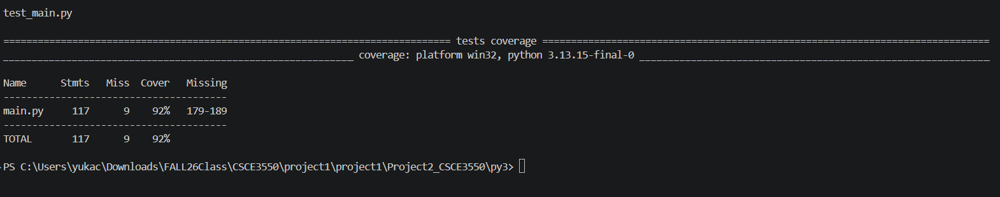
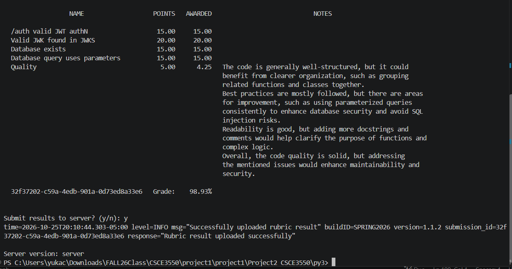

# Project2_CSCE3550

The base code is the provided on Canvas, CSCE3550.001

## Test Suite
Run from py3/:
    pip install -r requirements.txt
    python -m pytest --cov=main --cov-report=term-missing
Coverage(92%) screenshot: project2_test_suite_screenshot.png

This test suite is generated by Claude AI.

## Blackbox testing
Used gradebot test client

## AI use
I used Claude (Claude Code) for the following:
- Writing the pytest test suite (test_main.py).
- Help debug errors
- Fixing flake8 style issues in main.py.
- Helping me find the right commands, especially to run the Gradebot client.

I ran and checked all code and test myself.

## Prompt used to generate the test suite:

I'm doing a project: a JWKS server in Python (py3/main.py) that
stores RSA private keys in SQLite (totally_not_my_privateKeys.db).

Write a pytest test suite for it. Requirements:
- Test coverage must be over 80%, measured with pytest-cov.
- Use a temporary database for tests (tmp_path), never the real .db file.
- Cover: connect() creating the table, save_key(), seed_keys() (one valid
  and one expired key, no duplicates on a second call), read_privatekey()
  for expired and valid, read_all_valid_keys(), POST /auth (valid, ?expired,
  no key -> 500), GET /.well-known/jwks.json (only unexpired keys,
  kid matches the token's kid), and 405 for wrong methods/paths.
- Verify a token's signature using the key from the JWKS response.
- Don't change main.py. If you think main.py needs a change to be testable,
  tell me what and why first.

Give me the code in pieces and explain each test in one line.
Provide commands which runs the test suite. Mention what the expected output and what the test suite missing.

list of the Requirements
